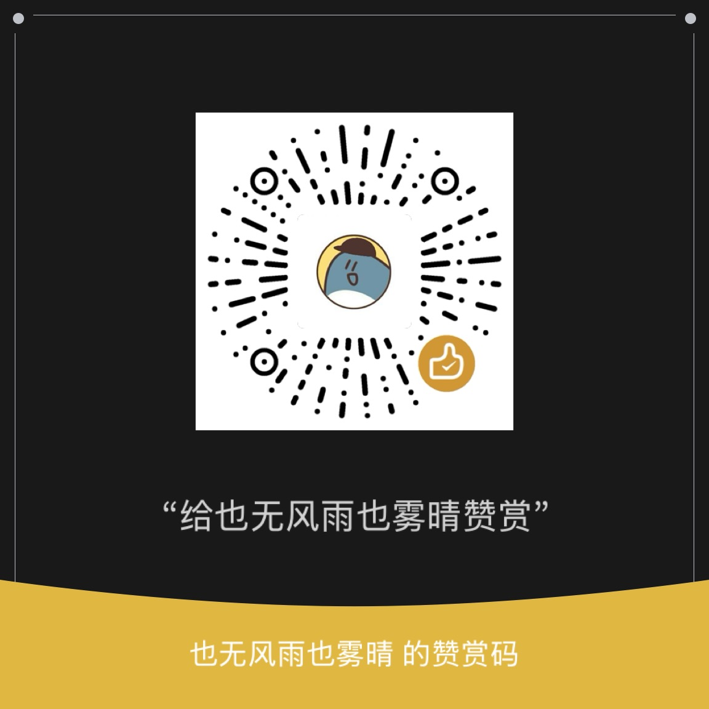

# youdao-dict-crack-mtp
有道词典笔 词典笔OS 基于MTP方案的破解方式（新版本生效）

**仅供参考，请认真对待学习！**

* 新版本 指的是已封堵HTTP Post请求的系统

# 使用方法

## 解锁ADB 

首先打开词典笔设置-关于-法律监管，在里面重复点击7次，提示打开adb时，将词典笔连接至电脑，在电脑只需执行 ```unlock.cmd``` 即可。

**受方法限制，此方法每次重启词典笔之后都需重新执行**

## 屏蔽系统更新

先解锁 ADB，将 `tools/ota-block` 目录中的脚本复制到设备的 `/userdata/ota-block` 目录，再通过 ADB Shell 执行 `cd /userdata/ota-block && sh control.sh enable` 即可屏蔽。
* ```control.sh restore```恢复
* ```control.sh status```查看状态

# 赞赏
如果此项目为您带来便利，请考虑赞赏！欢迎宣传

