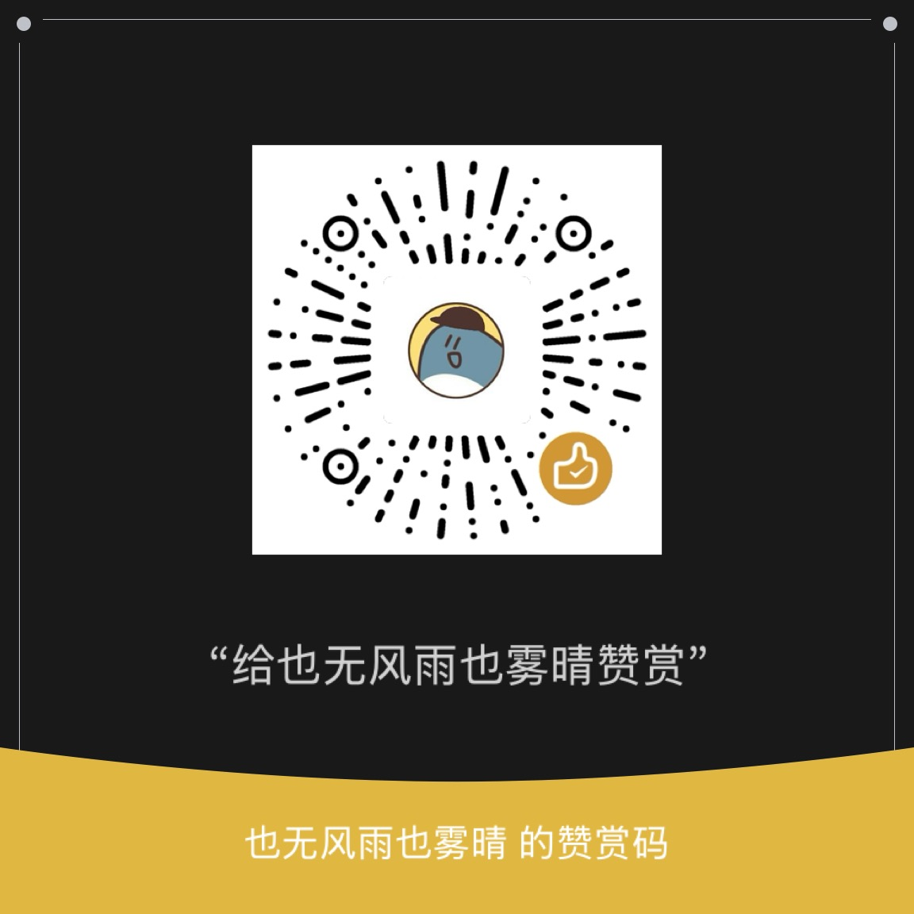

# youdao-dict-crack-mtp
有道词典笔 词典笔OS 基于MTP方案的破解方式（新版本生效）
**仅供参考，请认真对待学习！**
* 新版本 指的是已封堵HTTP Post请求的系统

# 使用方法
## 解锁ADB 
首先打开词典笔设置-关于-法律监管，在里面重复点击7次，提示打开adb时，将词典笔连接至电脑，在电脑只需执行 ```unlock.cmd``` 即可。

## 屏蔽系统更新
先解锁adb，然后将```tools```文件夹里面的```x7pro-ota-block```文件夹push到词典笔，在adb shell里面执行 ```control.sh enable``` 即可屏蔽
* ```control.sh restore```恢复
* ```control.sh status```查看状态

# 赞赏
如果此项目为您带来便利，请考虑赞赏！

